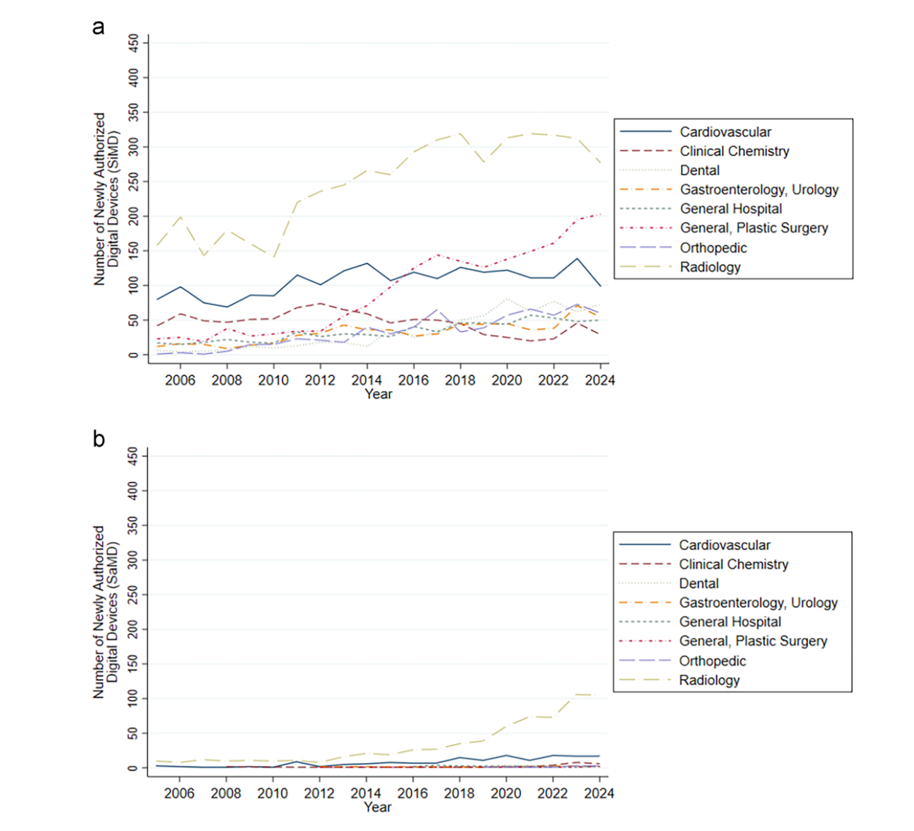
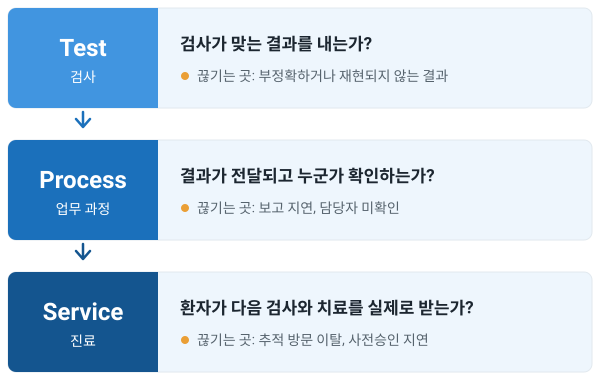

[지난 글](/cifellowship/tecd-immersion-2026-part-1/)에 이은 둘째 날 이야기.

첫째 날은 기술과 급여에 관한 이야기가 주였다면 둘째 날은 기술 자체에 대한 이야기가 주를 이뤘다.

수업은 총 네 가지였다.

### 강의 1: 디지털 헬스 앱과 소프트웨어형 의료기기

첫째 강의는 이 강의 (TECD)의 공동 디렉터인 Stern 교수님의 강의로, 디지털 헬스 앱 (Digital Health Application)과 소프트웨어형 의료기기 (Software as a Medical Device)에 관한 이야기였다.

개인적으로는 상당히 좋아하는 주제다.

옛날 글에서도 부분적으로 다루었지만 디지털 헬스케어와 관련된 이야기를 할 때 디지털 치료제는 단골로 등장하는 소재이기도 하니깐. 소프트웨어 그 자체를 의료기기로 등록하는 SaMD의 경우도 마찬가지였다.

의대생 시절 처음 이 분야에 관심을 가졌을 때부터 주목받았던 주제라, 레지던트 수련을 끝낸 현 시점에선 어떤 변화가 그간 있었는지가 내 개인적인 관심사였는데, 결론적으론 아직 갈 길이 멀다.

SaMD, 즉 소프트웨어를 의료기기로 취급하여 인가를 내주는 경우 필연적으로 따라오는 단점이 있다. 바로 소프트웨어는 정기적으로 업데이트된다는 점. 그런데 기능 업데이트할 때마다 허가를 새로 받을 순 없는 노릇 아닌가?

SaMD는 물리적 의료기기에 포함되지 않고 그 자체로서 의료 목적을 수행하는 소프트웨어를 말한다. 인슐린 펌프 안에 들어간 소프트웨어처럼 기기에 내장된 건 SiMD (Software in a Medical Device)라고 따로 부르는데, FDA 허가 건수로 보면 아직은 SaMD보다 SiMD가 아무래도 많다.

*위는 기기에 내장된 소프트웨어 (SiMD), 아래는 SaMD의 연도별 FDA 허가 건수. 출처: Everhart 등, [npj Digital Medicine 2026](https://doi.org/10.1038/s41746-026-02692-5) Fig. 3, CC BY 4.0.*

강의 내에선 소프트웨어가 계속 바뀌며 성능이 달라질 수 있고, 서비스가 중단되거나 하면 환자에게 악영향을 끼칠 수도 있으며 초기 버전의 모습으로 제품의 향후 모습을 예측하기 어렵다는 점 역시 지적되었다.

미국도 이 문제를 풀어보려 한 적이 있었다. 지난 글 끝에 잠깐 언급한 FDA의 Pre-Cert 파일럿인데, 소프트웨어를 버전마다 심사하는 대신 그걸 만드는 회사의 개발 관행을 보고 미리 인증해주자는 발상이었다. Apple, 삼성, Fitbit 등 9개 회사가 참여했지만 2022년에 종료되었다. 지금 FDA가 가진 법적 권한으로는 구현하기 어렵다는 게 결론이었다나.

또한, 규제만큼 큰 문제가 하나 더 있었으니 바로 급여. 결국 누가 이 비용을 지불하느냐에 뚜렷한 대답이 있어야 이 모든 것들이 지속가능하다.

대표적인 사례로는 독일의 DiGA가 언급되었다. Digitale Gesundheitsanwendung이라고 한다나?

디지털 헬스 제품을 약 처방 및 급여에 연결한 제도인데, 찾아보니 독일은 2019년 디지털 헬스케어 법 (Digital Healthcare Act)을 통해 디지털 헬스 앱의 규제와 급여를 처음으로 도입한 나라들 중 하나라고 한다.

DiGA의 경우 처방과 급여 경로에 디지털 헬스 앱을 연결한다. 보통 인허가를 내줄 땐 당연하지만 임상적 근거가 상당히 중요한데, DiGA는 안전성, 개인정보 보호, 상호운용성 같은 기본 요건을 맞춘 제품이라면 효능/효과에 대한 근거가 아직 부족해도 일단 잠정 등재를 해준다. 이 기간 동안 보험 적용을 받으면서 근거를 모으게 해 주는 식이다. 기간 안에 효과를 입증하면 정식 등재, 못 하면 탈락. (물론 위험도가 높은 Class IIb 기기는 잠정 등재 대상이 아님.)

임상 근거를 더 모을 시간을 확보시켜주는 식으로 디지털 헬스 앱들에 친화적인 규제 방향성이라 볼 수 있겠다.

입증해야 하는 효과가 꼭 증상 개선 같은 의학적 효능일 필요는 없다는 점도 재밌다. 치료 순응도나 접근성이 나아지는 것처럼, 진료의 구조나 과정이 좋아지는 것도 효과로 쳐주는 모양.

등재된 60여 개 앱을 분야로 보면 정신건강이 30개, 근골격이 8개, 내분비가 5개로 아직까지 주로 정신과적 질환 치료에 많이 치중하는 모습이긴 하다.

또 한 가지 언급된 부분은 디지털 치료제를 볼 때도 앱의 전체 내용 (full dose), 환자가 실제로 열어본 부분 (consumed dose), 이 중 실제 행동 변화로 이어진 부분 (realized dose) 등을 구분해서 보아야 한다는 점이었는데 흥미로웠다.

### 강의 2: 병리의 디지털 전환과 Test → Process → Service

병리 분야의 디지털 전환을 다룬 강의였다.

강의자는 Dr. Jochen Lennerz로 Natera의 medical director를 맡고 계셨다.

Natera는 혈액 속 cell-free DNA를 분석하는 검사로 알려진 미국의 진단 회사다. 산전 선별검사 (Panorama), 암 미세잔존질환 검사 (Signatera), 이식 거부반응 검사 (Prospera)가 대표적이다.

연사는 진단 기술을 볼 때 이런 질문들을 던져보아야 한다고 했다.

1. 정확하게 측정하느냐? (analytical validity)
2. 측정한 값이 실제 질환과 연결되느냐? (clinical validity)
3. 그래서 환자에게 이익이 되느냐? (clinical utility)
4. 이걸 기관이 운영할 수 있는가? (business value)

이런 식의 질문들.

앞 단계를 통과했다고 다음 단계가 따라오진 않는다. 알고리즘이 암을 잘 찾아낸다고 해서 치료 선택이나 예후가 좋아진다는 보장은 없으니까.

그리고 이 중 기억에 남은 표현은 **Test → Process → Service**.

- Test: 검사나 알고리즘이 맞는 결과를 내는가?
- Process: 검체 처리, 결과 보고, 전달과 확인 같은 업무가 제대로 돌아가는가?
- Service: 그래서 환자가 추가 검사나 치료까지 실제로 받는가?

*Lennerz 등의 Diagnostic Quality Model ([Clin Chem Lab Med, 2023](https://doi.org/10.1515/cclm-2022-1151))과 강의 내용을 바탕으로 그린 모식도.*

검사가 정확하면 뭐하나? 이 검사를 결국 진료에 반영해야 의미가 있는 법이다.

결과가 잘 나와도 담당자가 확인을 못 하거나, 환자가 다음 외래에 안 오거나, 보험 사전승인에 걸려 치료가 늦어지면 거기서 끝이다.

강의 후반부는 규제 이야기였다.

기술, 임상, 규제는 모두 다른 속도로 움직인다는 말을 하며, 계속 바뀌는 제품을 안전하게 다루는 데 쓸 수 있는 두 가지 접근법을 소개했다.

하나는 PCCP (Predetermined Change Control Plan). 앞으로 어디까지 바꿀지, 바꾸면 어떻게 검증할지를 미리 정해두는 방식이고 다른 하나는 shadow deployment. 실제 진료엔 영향을 주지 않는 상태로 옆에서 같은 케이스를 돌려보고 결과를 비교하는 방식이다. (물론 shadow로 잘 돌아갔다고 임상 효과가 입증되는 건 아니다.)

첫째 날의 last mile problem과 겹치는 내용이 좀 있었다.

### 강의 3: AI가 뛰어나면 학습에 악영향을 미칠까?

세 번째 강의 역시 Stern 교수님의 강의였다.

영상의학 AI 회사인 Aidoc의 케이스를 다뤘는데, 단순히 모델의 진단 성능에 주목하기보단 이 제품이 업무를 얼마나 통합했는지, 유통은 어떻게 시켰는지, 고객 관계는 어떠했으며 규제는 어떠했는지 총체적으로 살폈다.

강의의 핵심 내용은 두 부분이었다.

- 혁신은 규제와 사업 모델의 장벽이 낮을 때 일어난다는 점.
- 혁신의 도입은 그 혁신이 기존 지불 방식, 업무 흐름과 합쳐질 수 있을 때 비로소 성공한다는 점.

당연하지만 또 중요한 소리다.

Aidoc은 둘 다 챙긴 사례로 소개됐다. FDA 허가를 받은 알고리즘이 가장 많은 회사이기도 하고, 창업 초기부터 병원에서 시간을 많이 보냈으며, 처음엔 영상의학과에 제품을 팔다가 이후 병원 경영진 대상으로 판로를 넓혔다.

CEO의 말이 인상적이었는데 AI는 AI 자체에 관한 일이 아니라 사람을 돕도록 과정을 바꾸는 일이었다나? 개인적으로도 공감 가는 말이다.

회사가 모델을 직접 더 만들지, 아니면 다른 회사의 알고리즘도 제공하는 플랫폼이 될지에 대한 토론도 있었다. 플랫폼을 운영하면서 자기 제품까지 팔면, 그 위에 들어온 회사와 경쟁하게 된다. 첫째 날의 Epic과 Ambient Scribe 업체들 이야기와 겹치는 부분이다.

이후에는 AI가 의사의 기본기에 어떤 영향을 끼칠지에 대한 이야기도 이어졌는데, AI 덕분에 더 잘하게 되는 upskilling, 기존 실력이 줄어드는 deskilling, 처음부터 기본기를 익히지 못하는 never-skilling에 대한 시나리오를 생각하며 토론했던 듯하다.

솔직히 AI에 일을 맡길수록 일부 분야 실력을 덜 쌓게 되는 일은 불가피하지 않을까? 편한 길을 두고 돌아가는 사람은 없으니까. 팀에서 일하며 수련 중인 전공의들에게 AI 사용을 어디까지 허가해야 하나 하고 갑론을박이 오가는데, 이와도 연결되는 부분이다. 올바르게 일하는 방법을 익히고 이후 AI로 일을 편하게 만드는 일과, 이를 겪지 않고 곧바로 AI에 의존하는 건 아무래도 차이가 있으니까.

### 강의 4: AI Prompt-a-thon

마지막은 프롬프트 실습이었다.

여러 프롬프트 기법을 직접 써 봤는데, 하고 싶은 일을 먼저 설명하고 그 작업에 맞는 프롬프트를 AI에게 만들어 달라고 하는 reverse prompting도 있었다.

기본 틀로는 R-T-F를 소개했다. 역할 (Role), 할 일 (Task), 출력 형식 (Format)을 정해주는 것.

예전에 프롬프트를 이것저것 만져 본 적이 있어서 친숙한 내용이었다. 그사이 달라졌다고 느낀 점도 있다. 예전엔 마크다운이나 HTML 같은 형식으로 지시를 세세하게 구조화하는 데 신경을 많이 썼는데, 요즘 내가 쓰는 모델은 그런 형식을 덜 챙겨도 의도를 알아듣는 경우가 많다.

그래도 역할을 정해 주고, 원하는 결과와 조건을 설명하고, 무엇을 더 고민해야 할지 되묻는 방식은 여전히 쓸모 있었다.

프롬프트가 아니라 답을 평가하라는 말도 있었다. 근거가 확인 가능한지, 실제 문제를 푸는지, 뭐가 빠졌는지, 누구의 관점이 빠졌는지, 읽는 사람이 이걸로 행동할 수 있는지 말이다.

---

셋째 날 이야기는 다음 글에서 이어가는걸루.
