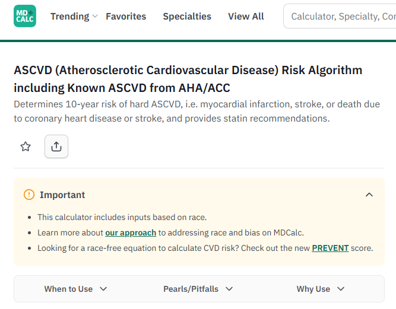
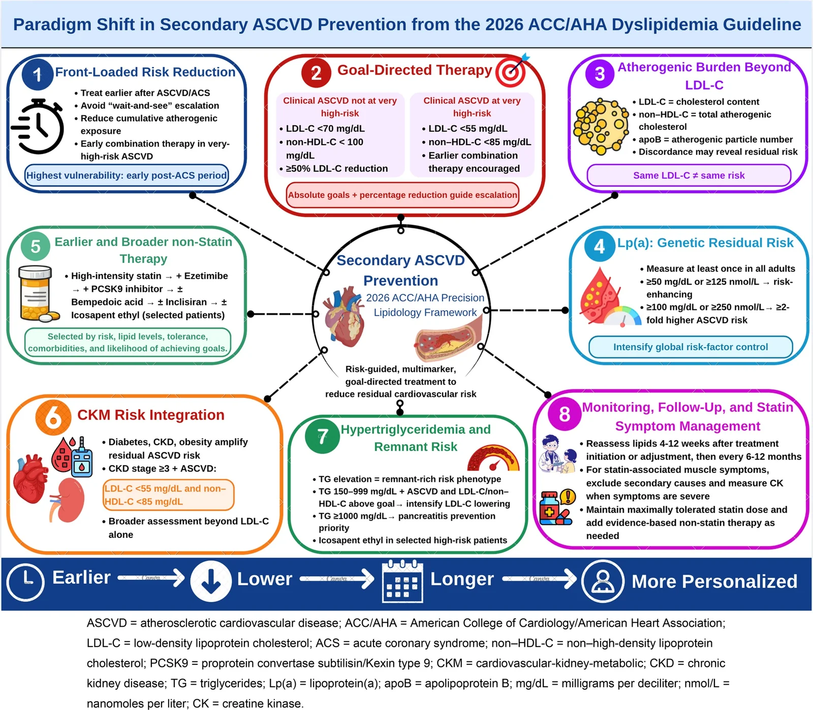
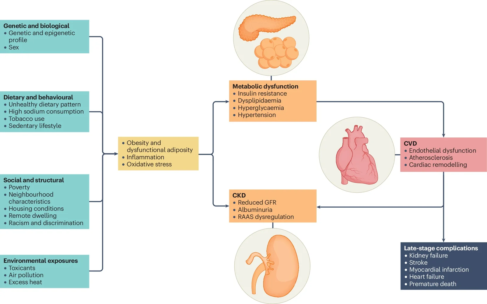
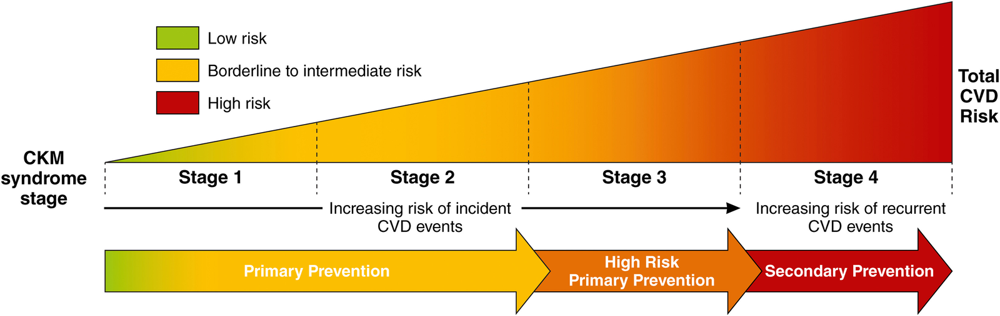
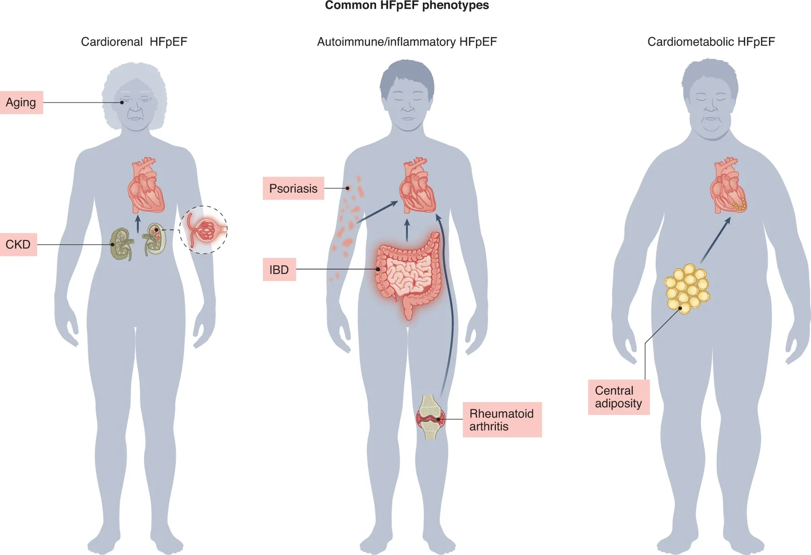
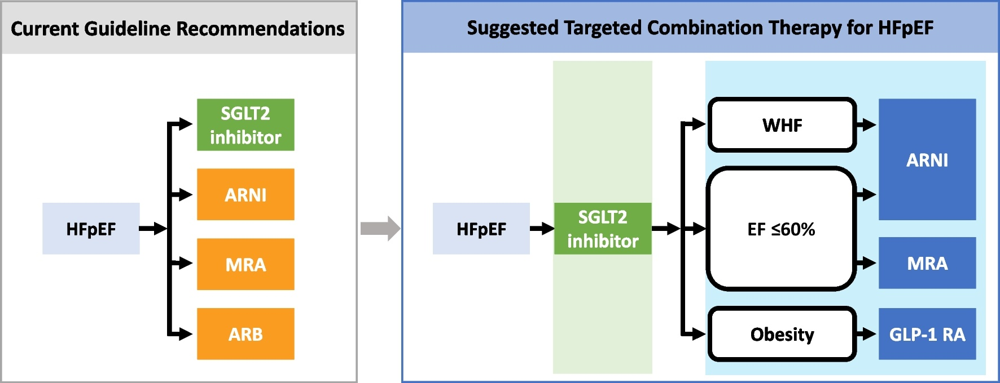
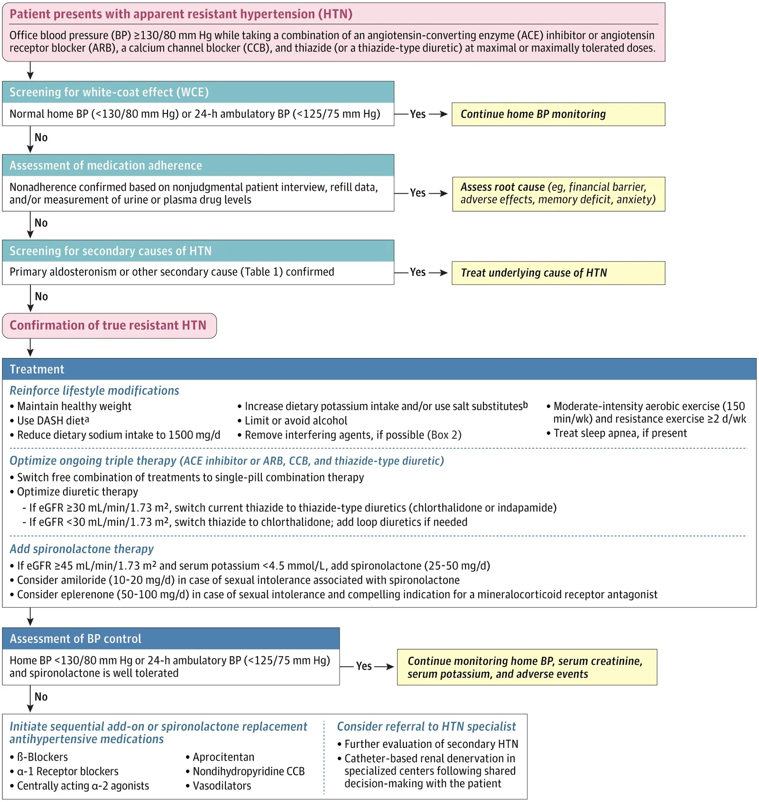

1차 진료에서 쓰이는 지침들이 여럿 바뀐 한 해였다. 나올 때마다 공부하긴 했는데, 한 곳에 모아두고 본 적은 없으니 공부 목적을 겸해 글을 작성하고자 한다.

각 항목에서는 각각 가이드라인이 어떻게 개정되었는지 등을 간결히 다룰 듯?

한 눈에 큰 분류를 보고 싶다면 상기된 목차를 참조하면 된다.

적다 보니 많아졌네... 심혈관/대사질환 먼저 적어야지.

> 공부 목적으로 정리한 개인 노트입니다. 개별 환자에 대한 의학적 조언이 아니며, 진료 결정은 원문 지침과 담당 의료진의 판단을 따라 주세요.

---

## 심혈관·대사질환

### 고지혈증/이상지질혈증: 2026 ACC/AHA 다학회 지침

기존에는 고지혈증 환자의 10년 심혈관 위험을 예상해서 약처방을 했다.

주로 이렇게 MDCalc 앱 등을 통해 위험확률을 계산했었지.

그런데 이제는 새로운 스코어가 나왔다. 바로 **PREVENT-ASCVD**!

바뀐 부분을 간략히 이야기하자면.

- 30세 이상, 80세 미만에서 10/30년 심혈관위험을 계산하는 새로운 모델임.
- 애매하면 CAC, 그니까 관상동맥에 칼슘이 얼마나 껴 있는지 등을 바탕으로 다시 한번 분류 가능.
- 기존에는 10년 위험이 7.5% 이상일 시 콜레스테롤 약을 권장하는 식이었는데, 이젠 10년 위험 3% 이상부터 고려 가능. 5–10%는 고려해야 하며, 10% 이상이면 고강도 스타틴으로 LDL-C 50% 이상 감소 및 <70 mg/dL로 낮추는 걸 목표로 해야 함.
- LDL-C, non-HDL-C 목표 수치가 빠졌었는데 다시 돌아왔다. 환자 위험도에 따라 다르기는 한데, 초고위험군은 LDL < 55, nHDL < 85고 그 밖의 심혈관질환력/고위험의 경우 LDL < 70, nHDL < 100이다. 경계/중등도는 LDL<100 이 목표.
- 초고위험으로 분류되는 요건은 주요사건 2회 이상, 혹은 주요사건 1회 + 고위험 조건 2개 이상. 여기서 주요 사건은 심근경색, 관상동맥증후군, 허혈성 뇌졸중, 증상 있는 말초동맥질환임.
- Lipoprotein(a)도 성인기에 한 번 측정하라고 한다. 125 nmol/L 이상이면 위험인자로 보고, 250 nmol/L 이상이면 위험이 2배라 LDL < 70을 목표로 약도 쓰고 가족도 선별하고 해야 함.
- apoB는 추가 판단에 쓰는 듯. 일단 LDL, nHDL 목표에 도달한 후. 중성지방 > 200, 당뇨, LDL < 70인 경우 특히 쓸모가 있단다.
- HIV, 40–75세 당뇨환자, CKD 3기 이상은 수치와 상관없이 LDL 낮추는 치료를 해야 함.
- 2차 약제 선택 폭이 좀 더 넓어짐. 스타틴 다음에 꼭 ezetimibe를 거치기보다 ezetimibe, bempedoic acid, PCSK9 mAb 등 상황에 따라 고르면 된다는 느낌.

개인적으로 제일 와닿는 부분은 나이 범위가 30세로 내려왔다는 점?

기존 risk 계산기는 40세 이상을 대상으로 했기에 어지간해선 40세 미만에서는 생활습관 개선을 권유했더란다. 근데 이제 PREVENT 상에서 리스크가 꽤 높다면 30~40대 구간에서도 statin 고려를 해야 하는 것이다.

사실 한 번 약을 시작하면 끊는 게 쉽지 않기에 (약 늘리는 판단은 쉬워도 약 줄이거나 끊는 판단은 어려운 경우가 많더라) 가급적이면 젊은 환자들 대상으론 약을 신중하게 시작했었는데 (일단 운동/식이로 조절되나 보자고), 이젠 더 약을 적극적으로 써야 할지도 모르는 일.

### CKM 증후군 2026: 비만지침의 변화

CKM이란?
Cardiovascular-Kidney-Metabolic, 즉 심혈관-신장-대사 증후군이다.

간단히 말해 심장, 콩팥, 그리고 당뇨/비만을 위시한 대사질환 사이의 상호작용으로 건강이 나빠지는 상황을 일컫는다.

사실 조금 생소한 개념이기 쉬운 게, 이게 2023년에 미국심장협회(AHA)가 회장 자문(Presidential Advisory)으로 새로 정의한 개념이다. 이전까진 만성신질환/심혈관질환/비만/당뇨 등을 다 따로 다뤘는데, 이 모든 걸 한데 묶어 보는 임상지침으로서 만든 게 이번 2026 CKM 지침이라 보면 되겠다. 진료실에서 붙일 수 있는 ICD 코드는 아직 없는 듯? 그나마 대사증후군이 유사하려나.

2026 Nature Reviews Nephrology.

대충 대사이상 > 만성신질환 > 심혈관질환이 하나의 축으로 연결되어 있다는 소리.

CKM은 병기(stage)가 있다. 0기부터 4기까지.

만성신질환은 당연히 병기가 있고, 비만도 의학적으론 1기 2기 뭐 이렇게 병기를 분류할 수 있다 (환자에게 당신은 n기 비만입니다 하는 말은 쓴 적 없다. 나를 싫어하게 될지도). 그런 의미에서 CKM에 병기가 있는건 당연하다고도 하겠다.

뭐 아무튼, 2026 CKM을 간단히 살펴보자면

- 청소년/성인 모두 병기 0–4기 적용 가능.
  기준은 다양한데, PREVENT 기준 CVD 위험이 20% 넘는다든가, 심방세동이 있다든가, 심부전이 있다든가 등 다양한 기준으로 비교한다.
- 뭐 자세한 선별 주기 이야기는 여기서는 패스
- 체중 볼 땐 BMI/허리둘레를 함께 보는 정도는 참고할 만하고
- 비만/대사증후군을 CKD/CVD와 함께 관리하는 하나의 개념적인 흐름으로 정리한 게 제일 중요한 성과일지도. CKM 2–4기에서는 협진 및 CKM 진료를 조율하는 담당자를 두도록 권고함.

비만/대사증후군이 만병의 원인이라는 말이야 뭐 많았지만 이렇게 직접적으로 다른 질환들과 연결시켜 체계적인 관리를 시작한다는 점은 상당히 흥미로웠음.

### 심부전 관련 가이드라인 (Second Universal Definition of HF)

심부전 관련 가이드라인도 좀 바뀌었음. AHA, ACC, ESC, WHF 등등 뭐 미국 유럽 다양한 학회들이 만든 거라 범세계적으로 업데이트되었다 보면 될 듯.

바뀐 부분을 간략히 이야기하자면.

- 원랜 심부전을 EF(박출률) 숫자 기반으로 reduced EF, preserved EF 등으로 나눴었음. 40% 이하면 HFrEF(감소), 41–49%면 경도 감소(mildly reduced, HFmrEF) 등등...
- 그런데 이런 숫자 기반 분류는 더 이상 안 쓰기로 결정. 성별, 나이, 인종 등 다양한 인자들에 영향을 받기 때문에 숫자만 갖고 자르는건 애매하다 판단한 모양임.
- HFmrEF는 사라짐. 조금 낮든 많이 낮든 어차피 심부전 약에 도움받는 건 같으니 그냥 HFrEF로 묶은 듯.
- HFimpEF(개선된 EF): EF가 10%p 이상 올라서 40%를 넘긴 경우.
- 원인도 보통 HF는 허혈성/비허혈성 두 갈래 정도로만 크게 갈렸는데 이제 19개 정도로 쪼개짐. 뭐 이유도 다양하다. 고혈압성, 판막, 부정맥, 침윤성, 독성, 임신 관련... 사실 비허혈성 안에 다양한 원인 인자들이 들어가 있었는데 이걸 더 세분화한 느낌.
- 심부전이 좋아지는 경과에도 이름들이 붙었음. 예를 들어
	- 호전 (improvement) - EF 올랐는데 아직 이상은 남음
	- 관해 (remission) - 정상화되긴 했지만 재발가능
	- 회복 (recovery) - 심장 기능, 심장 구조, 증상 까지 다 정상이 된 상태
	- 사실상 대부분 관해까지 가지 회복까지 가긴 어렵지 않나 싶다
- 악화 (Worsening)와 비대상성 (decompensated)도 구분하기 시작함. 이뇨제를 기존보다 올리는 식으로 더 강한 치료를 해서 증상 조절을 해야 했는지 여부로 판단하는 듯하다.

HFmrEF가 사라지긴 했는데 EMR에서 청구하거나 할 땐 여전히 남아있을테니 그사이 혼선은 좀 있지 않을까 싶다.

분류가 달라지긴 했지만 치료적인 측면을 생각하면 사실 별로 달라진 건 없는지도.

### HFpEF: 2026 ACC 전문가 합의

2023년에 있었던 가이드라인이 개선됨. 이 사이 finerenone이나 GLP-1 계열 약들 연구결과도 있어서 얘네가 반영된 듯하다.

뭐 질환의 정의적인 측면에서는 HFpEF가 내장지방/염증/대사이상이 복합적으로 작용하여 발생하는 다계통 증후군으로 본다는 점이 특이할 만함. 위의 CKM도 그렇고 이렇게 기존의 질환들을 다양한 축들이 함께 작용하는 질환으로 보는게 요즘 트렌드인 듯? 뭐 우리 몸은 다 연결되어 있으니 더 정확한 정의라고도 할 수 있겠다.

대충 HFpEF는 심장-신장형, 자가면역/염증형, 심장-대사형의 다른 표현형이 있다는 그림.

대충 바뀐 부분들은

- 진단은 H2FPEF로 1차 선별하고 HFA-PEFF로 확인. 둘 다 애매한 중간 구간이면 부하 심초음파나 침습적 혈역학 검사까지 가라는 건데, 현실적으로 거기까지 하는 경우는 드물다. 그래서 실제로는 이뇨제 같은 약에 반응하는지 보면서 진단을 굳혀가는 경우가 더 흔한 듯.
- 다만 약에 반응했다고 HFpEF로 확정되는 건 아니라서, 아밀로이드증 같이 HF와 유사하게 증상이 나타나는 질환들은 따로 거르라는 게 이번 지침에서 강조하는 부분임.
- BNP가 낮다고 HFpEF가 아닌 게 아니라고 재차 강조. 뭘 새삼? 어차피 심부전은 임상진단 아니었나?
  뭐 BNP 낮다고 하면 심부전을 배제하는 관행이 좀 있으니 이렇게 재차 강조하는 듯 보인다.
- 약물치료는 보통 SGLT2i + nsMRA를 먼저 깔고 (이 중에선 finerenone이 spironolactone보다 우선), 증상에 따라 추가적으로 쌓아 올리는 느낌임. 대충 아래 그림과 같다.

- 비만 HFpEF에서는 semaglutide, tirzepatide... 그러니까 위고비, 마운자로/젭바운드가 유의미한 증상개선/심혈관사망/심부전 입원 등을 줄였다는 듯하다. 그래서 여기서 권고도 BMI 30 이상이면 이 두 약 우선하기.
- 실무적으로 주요한 부분은 베타차단제 습관적으로 쓰지 말라는 것. HFpEF에선 이득이 입증된 적이 없고, 심박수가 충분히 안 올라가게 만들어서(chronotropic incompetence) 운동 내성을 떨어뜨려 오히려 안 좋을 수 있다고 한다. 협심증이든 심방세동이든 별도 적응증이 있을 때 고려하라고 한다.
- ARNI 역시 여성이나 EF 55–60% 미만이면 써볼 만하고, 안 되면 ARB 고려하라는 듯

HFpEF는 증상조절에 치중하는 느낌이었는데 이젠 HFrEF처럼 마치 GDMT 하듯 선택지가 많이 생긴 느낌. SGLT2i, MRA, GLP-1 RA 등을 적극적으로 고려할 문헌적 근거가 생김.

### 저항성 고혈압: 2026 ACC 전문가 합의

2025년에 AHA/ACC에서 발표한 고혈압 지침이 있었는데 그걸 어떻게 실제적으로 반영할지 정리한 부분에 가까움.

한 짤로 요약 가능.

뭐 말로 굳이 풀어쓴다면

- 저항성 고혈압의 정의: 이뇨제 포함 서로 다른 계열 3제를 (ACEi/ARB, CCB, thiazide 계열 조합이어야 함) 최대 내약 용량으로 써도 130/80 이상이거나, 4제 이상 써야 조절되는 경우. 확인은 24시간 활동혈압이 제일 좋다.
- RESIST: 진짜 저항성 고혈압인지 알아보는 일종의 틀임. 백의 고혈압을 배제하고, 혈압 올리는 약이나 물질 빼보고, 생활습관 고쳐보고, 약 더 써보고, 고혈압의 이차성 원인이 있는지도 찾고, 그래도 안 되면 전문의에게 의뢰하라는 식.
- 약 순서는 thiazide부터 쓰는데 chlorthalidone·indapamide 같은 thiazide-like로 바꾸는게 더 강력하고 반감기도 길어 권장. (CKD에 특히 chlorthalidone이 좋다)
- 4번째 약을 고른다면 MRA(spironolactone, eplerenone). 시작 전엔 레닌·알도스테론, 시작 후엔 칼륨·크레아티닌 체크해줘야 함. 고칼륨혈증이 있거나 eGFR < 30이면 쓰지 않기.
- 5번째 약제를 넣는다면 aprocitentan이나 baxdrostat를 고려하라 함. 전문의랑 상의하고.
	- baxdrostat는 올해 5월에 FDA 승인 받은 첫 알도스테론 합성효소 억제제임.
	- aprocitentan은 endothelin A/B 수용체 길항제. 부작용은 하지 부종 및 체액저류.
- 이거 다 안되면 신장신경차단술(renal denervation); 보조적인 옵션이고 효과는 위약대비 24시간 SBP -4.4, 진료실 SBP -6.6 mmHg라 좀 완만한 편이다.

1차 진료 입장에서 제일 쓸모 있는 건 아마도 RESIST? 저항성 고혈압 딱지를 붙이기 전에 배제해야 하는게 워낙 많으니까 이런걸 템플릿이나 워크플로에 녹여낼 수 있다면 편할 듯.

---

쓰다 보니 길어져서 심혈관계만 우선 정리하고 다른 지침들은 새 글을 파야 할 듯싶다.

## 참고문헌

1. Development and Validation of the American Heart Association's PREVENT Equations. *Circulation*. 2024. [doi:10.1161/CIRCULATIONAHA.123.067626](https://doi.org/10.1161/CIRCULATIONAHA.123.067626)
2. 2026 ACC/AHA/AACVPR/ABC/ACPM/ADA/AGS/APhA/ASPC/NLA/PCNA Guideline on the Management of Dyslipidemia. *Circulation*. 2026. [doi:10.1161/CIR.0000000000001423](https://doi.org/10.1161/CIR.0000000000001423) · [동시 게재 JACC](https://doi.org/10.1016/j.jacc.2025.11.016)
3. Cardiovascular-Kidney-Metabolic Health: A Presidential Advisory From the American Heart Association. *Circulation*. 2023. [doi:10.1161/CIR.0000000000001184](https://doi.org/10.1161/CIR.0000000000001184)
4. 2026 AHA/ACC/ADA/ASN Guideline for the Prevention, Detection, Evaluation, and Management of Cardiovascular-Kidney-Metabolic Syndrome. *Circulation*. 2026. [doi:10.1161/CIR.0000000000001453](https://doi.org/10.1161/CIR.0000000000001453)
5. AHA/ACC/ESC/WHF Expert Consensus Document: Second Universal Definition of Heart Failure (2026). *Circulation*. 2026. [doi:10.1161/CIR.0000000000001455](https://doi.org/10.1161/CIR.0000000000001455) · [Global Heart, 공개 전문](https://doi.org/10.5334/gh.1569)
6. Management of Heart Failure With Preserved Ejection Fraction: 2026 ACC Expert Consensus Decision Pathway. *JACC*. 2026. [doi:10.1016/j.jacc.2026.06.018](https://doi.org/10.1016/j.jacc.2026.06.018)
7. 2025 AHA/ACC/AANP/AAPA/ABC/ACCP/ACPM/AGS/AMA/ASPC/NMA/PCNA/SGIM Guideline for the Prevention, Detection, Evaluation and Management of High Blood Pressure in Adults. *Circulation*. 2025. [doi:10.1161/CIR.0000000000001356](https://doi.org/10.1161/CIR.0000000000001356)
8. Optimizing Blood Pressure Care in Patients With Resistant Hypertension: 2026 ACC Expert Consensus Decision Pathway. *JACC*. 2026. [doi:10.1016/j.jacc.2026.08.028](https://doi.org/10.1016/j.jacc.2026.08.028)
